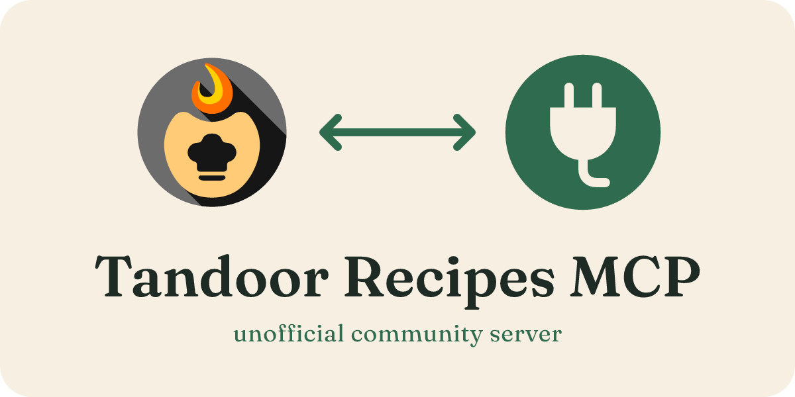

<p align="center"></p>

<h1 align="center">Tandoor Recipes MCP</h1>

<p align="center"><strong>Turn "plan the week and make me a grocery list" into one prompt.</strong></p>

<p align="center">Recipes, meal plans, shopping lists and more for your local or self-hosted Tandoor instance.</p>

<p align="center">
  <a href="https://www.npmjs.com/package/@cliftonz/tandoor-recipes-mcp"></a>
  <a href="https://www.npmjs.com/package/@cliftonz/tandoor-recipes-mcp"></a>
  <a href="https://github.com/Cliftonz/tandoor-recipe-mcp/pkgs/container/tandoor-recipes-mcp"></a>
  <a href="https://registry.modelcontextprotocol.io/v0/servers?search=io.github.Cliftonz/tandoor-recipe-mcp"></a>
  <a href="https://glama.ai/mcp/servers/Cliftonz/tandoor-recipe-mcp"></a>
  <a href="https://github.com/Cliftonz/tandoor-recipe-mcp/actions/workflows/ci.yml"></a>
  <a href="https://scorecard.dev/viewer/?uri=github.com/Cliftonz/tandoor-recipe-mcp"></a>
  <a href="LICENSE"></a>
</p>

<p align="center">
  <a href="https://glama.ai/mcp/servers/Cliftonz/tandoor-recipe-mcp"></a>
</p>

<p align="center">
  <a href="#install">Install</a> ·
  <a href="#configure">Configure</a> ·
  <a href="#remote-mode">Remote mode</a> ·
  <a href="#tool-sections">Tool sections</a> ·
  <a href="#example-conversations">Example conversations</a> ·
  <a href="#contributing">Contributing</a>
</p>

<p align="center"><sub>Unofficial community project, not affiliated with Tandoor. Tandoor logo © TandoorRecipes, used to show compatibility.</sub></p>

A Model Context Protocol (MCP) server that gives LLM agents full read/write access to a [Tandoor Recipes](https://tandoor.dev) instance: recipes, meal plans, ingredients, shopping lists, cook logs, nutrition, AI-powered URL/image imports, invite/access tokens, storages, sync, spaces, exports, imports, and more.

## What's new in 3.4

- **Remote mode for Claude and ChatGPT.** Host the server next to your Tandoor and add it as a custom connector in Claude or ChatGPT. Each person signs in with their own Tandoor API token. See [Remote mode](#remote-mode).
- **Docker image on GHCR.** Each release pushes a signed multi-arch image to `ghcr.io/cliftonz/tandoor-recipes-mcp`. See [Run with Docker](#run-with-docker).
- **MCP Registry listing.** Stable releases publish `server.json` to the MCP Registry, with the npm package, the `.mcpb` file and the Docker image.
- **Titles and annotations on every tool.** All 306 tools declare a title and the read-only, destructive, idempotent and open-world hints.
- **Host and Origin checks, plus rate limits.** Remote mode checks the Host and Origin headers and rate limits each visitor on `/mcp`. See [Remote mode security](#remote-mode-security).

See [CHANGELOG.md](CHANGELOG.md) for earlier releases.

## Why this server

- **Full Tandoor 2.6 API coverage.** 306 typed tools, spanning every domain the Tandoor OpenAPI exposes. With the default settings, 46 are visible at startup.
- **Resources + prompts, not just tools.** Read-only resources like `tandoor://meal-plan/this-week` and `tandoor://pantry/on-hand`, plus ready-made prompts (`plan_week`, `grocery_list_for_plan`, `what_can_i_make_tonight`). Most Tandoor MCP forks ship tools only.
- **Slim-by-default responses.** A full recipe GET shrinks from ~20k characters to ~2k by stripping substitute trees, readonly timestamps, image URLs, etc. Pass `format: "full"` anywhere for the raw Tandoor response.
- **Per-section tool settings.** One env var per section (recipes, meal plan, shopping, and so on) sets it. Tiered sections take `off`, `simple`, or `full`. Toggle sections take `off` or `on`. In stdio mode the LLM can turn a hidden section on mid-session with `enable_tool_group`. See [Tool sections](#tool-sections).
- **jq stash for large payloads.** Responses larger than 5KB return a stash handle plus a schema summary; the LLM follows up with `jq_query` to project just the fields it needs.
- **3-stage URL import with a real fallback.** Tries Tandoor's native scraper first, then extracts schema.org JSON-LD from the page directly (works when Tandoor can't reach the URL or doesn't support the site), with an optional stub-on-failure escape hatch.
- **AI import from images / PDFs.** Multipart upload to Tandoor's `ai-import/` endpoint, saves the parsed recipe.
- **Local or remote.** Stdio (default, for Claude Desktop / Claude Code), stateless HTTP (for out-of-Claude callers), or [remote mode](#remote-mode): a self-hosted server with OAuth sign-in that Claude and ChatGPT connect to as a custom connector.
- **Destructive-action safety layer.** Every tree-shaped delete has a `preview_*` sibling that projects the cascade before it runs; every token-mint tool leads with an ESCALATION SURFACE warning.

## Install

```bash
npm install -g @cliftonz/tandoor-recipes-mcp
```

Or `npx` without installing:

```bash
npx -y @cliftonz/tandoor-recipes-mcp
```

Node 24 or later is required (see `engines.node` in `package.json`).

Other ways to get it:

- **Claude Desktop extension:** `tandoor-recipes-mcp.mcpb` from the [latest GitHub release](https://github.com/Cliftonz/tandoor-recipe-mcp/releases/latest). It needs no Node install. See [Claude Desktop, desktop extension](#claude-desktop-desktop-extension).
- **Docker image:** `ghcr.io/cliftonz/tandoor-recipes-mcp`, for linux/amd64 and linux/arm64, tagged with each version and `latest`. The image starts in [remote mode](#remote-mode) by default.
- **MCP Registry:** listed as `io.github.Cliftonz/tandoor-recipe-mcp` in the [MCP Registry](https://registry.modelcontextprotocol.io), with the npm package, the `.mcpb` file and the Docker image.
- **Claude Code plugin and Codex plugin:** see [Configure](#configure).

## Configure

1. In Tandoor: **Settings, API Tokens, Create new token**.
2. Point your MCP client at the server.

### Claude Code, one-shot plugin install

```
/plugin marketplace add Cliftonz/tandoor-recipe-mcp
/plugin install tandoor-recipes-mcp@cliftonz-tandoor
```

From a terminal, the same two steps are:

```bash
claude plugin marketplace add Cliftonz/tandoor-recipe-mcp
claude plugin install tandoor-recipes-mcp@cliftonz-tandoor
```

Claude Code prompts you for `TANDOOR_URL` and `TANDOOR_TOKEN` on install and stores the token securely. No `mcpServers` JSON editing needed.

### Claude Desktop, desktop extension

Use the desktop extension for Claude Desktop Chat and Cowork. It bundles the server and runs on Claude Desktop's built-in Node, so you do not need to install Node.

1. Download [`tandoor-recipes-mcp.mcpb`](https://github.com/Cliftonz/tandoor-recipe-mcp/releases/latest/download/tandoor-recipes-mcp.mcpb) from the latest GitHub release.
2. Double-click the file. Or, in Claude Desktop, open **Settings > Extensions > Advanced settings > Install Extension** and select the file.
3. Enter your Tandoor URL and API token. Claude Desktop stores the token securely.
4. Optional: set the [section settings](#tool-sections) you want.

### Claude Desktop, plugin marketplace

Claude Desktop can also add the plugin:

1. Open **Customize > Plugins > Add > Add marketplace > Add from a repository**.
2. Enter `Cliftonz/tandoor-recipe-mcp`.
3. Open **Customize > Plugins > Discover**, select the plugin, and select **Add**.

This path does not give you a working server in Chat or Cowork. Chat and Cowork do not prompt for plugin settings, so the plugin's Tandoor URL and API token settings stay empty. Chat ignores local MCP servers from plugins. Cowork loads them only when the session runs on your computer. Use the [desktop extension](#claude-desktop-desktop-extension) or the [manual config](#claude-desktop--claude-code-manual-config) instead. Use the plugin from the Claude Code CLI.

### Claude Desktop / Claude Code, manual config

Edit the Claude Desktop config file:

- macOS: `~/Library/Application Support/Claude/claude_desktop_config.json`
- Windows: `%APPDATA%\Claude\claude_desktop_config.json`

For Claude Code, put the same `mcpServers` block in a project `.mcp.json`, or use `claude mcp add`.

```json
{
  "mcpServers": {
    "tandoor": {
      "command": "npx",
      "args": ["-y", "@cliftonz/tandoor-recipes-mcp"],
      "env": {
        "TANDOOR_URL": "https://your-tandoor-instance.com",
        "TANDOOR_TOKEN": "your-api-token"
      }
    }
  }
}
```

Quit and reopen Claude Desktop to load the change. This config runs the server with `npx`, so Node 24 or later must be on your `PATH`.

### Codex

The ChatGPT desktop app, the Codex CLI, and the Codex IDE extension share one config file, `~/.codex/config.toml`. Every Codex path below runs the server with `npx`, so Node 24 or later must be on your `PATH`.

#### Codex, settings

1. In the app, open **Settings > MCP servers > Add server**.
2. Choose **STDIO**.
3. Set the command to `npx`.
4. Add the arguments `-y` and `@cliftonz/tandoor-recipes-mcp`.
5. Add the environment variables `TANDOOR_URL` and `TANDOOR_TOKEN`. Add any `TANDOOR_MCP_*` [section settings](#tool-sections) you want.
6. Select **Save**, then restart the app.

From a terminal, the same setup is:

```bash
codex mcp add tandoor \
  --env TANDOOR_URL=https://your-tandoor-instance.com \
  --env TANDOOR_TOKEN=your-api-token \
  -- npx -y @cliftonz/tandoor-recipes-mcp
```

`codex mcp add` writes this block to `~/.codex/config.toml`. You can also add it to `config.toml` by hand:

```toml
[mcp_servers.tandoor]
command = "npx"
args = ["-y", "@cliftonz/tandoor-recipes-mcp"]

[mcp_servers.tandoor.env]
TANDOOR_URL = "https://your-tandoor-instance.com"
TANDOOR_TOKEN = "your-api-token"
```

#### Codex, plugin

1. Open the **Plugins** page and select **Add > Add a marketplace**.
2. Enter the source `Cliftonz/tandoor-recipe-mcp`.
3. Open the Tandoor plugin's details and select the plus button.
4. Restart the app.

From a terminal:

```bash
codex plugin marketplace add Cliftonz/tandoor-recipe-mcp
codex plugin add tandoor-recipes-mcp@cliftonz-tandoor
```

Codex does not prompt for settings on install, and you cannot override a plugin's environment. The plugin passes through only `TANDOOR_URL` and `TANDOOR_TOKEN` from the app's environment. An app you start from the Dock usually does not see exports in `~/.zshrc`. On macOS, set the variables for your login session and then restart the app:

```bash
launchctl setenv TANDOOR_URL https://your-tandoor-instance.com
launchctl setenv TANDOOR_TOKEN your-api-token
```

`launchctl setenv` does not survive a reboot. It also exposes the token to every app you start in that session.

The Codex plugin does not pass through section settings. To change sections, use [saved sections](#saved-sections) or the [settings path](#codex-settings).

### Recommended Claude Code permissions

The repo ships a `.claude/settings.json` that auto-allows read tools and prompts for everything else. Copy these into your own project's `.claude/settings.json` to reduce permission friction:

```json
{
  "permissions": {
    "allow": [
      "mcp__tandoor__list_*",
      "mcp__tandoor__get_*",
      "mcp__tandoor__preview_*"
    ],
    "ask": [
      "mcp__tandoor__create_*",
      "mcp__tandoor__update_*",
      "mcp__tandoor__delete_*",
      "mcp__tandoor__merge_*",
      "mcp__tandoor__switch_active_space",
      "mcp__tandoor__create_access_token",
      "mcp__tandoor__create_invite_link",
      "mcp__tandoor__get_external_recipe_file_link"
    ]
  }
}
```

## Transport modes

The server ships two transports. Default is `stdio`; opt in to HTTP with an env var. HTTP also has a remote mode for Claude and ChatGPT custom connectors.

| Mode | When to use | Auth |
|---|---|---|
| `stdio` (default) | Claude Desktop, Claude Code, any MCP client that spawns the server as a subprocess. | Inherited from parent process. |
| `http` (stateless) | Out-of-Claude callers, local scripts, other agents on the same host. | Optional bearer via `TANDOOR_MCP_HTTP_TOKEN`. |
| `http` with `TANDOOR_MCP_PUBLIC_URL` ([remote mode](#remote-mode)) | Claude (web, mobile, Desktop, Cowork, Code) and ChatGPT, through your own HTTPS URL. | OAuth sign-in. Each user pastes their own Tandoor API token. |

### HTTP mode

```bash
TANDOOR_URL=https://tandoor.example.com \
TANDOOR_TOKEN=... \
TANDOOR_MCP_TRANSPORT=http \
TANDOOR_MCP_HTTP_PORT=3737 \
TANDOOR_MCP_HTTP_TOKEN=some-long-random-string \
npx -y @cliftonz/tandoor-recipes-mcp
```

The server listens on `http://127.0.0.1:${TANDOOR_MCP_HTTP_PORT:-3737}/mcp` (POST only for JSON-RPC requests). Any other method on that path gets a 405 with `Allow: POST` and a JSON-RPC error body. Auth is checked first, so a request without a valid token gets a 401 instead. The server binds to `127.0.0.1` unless you set `TANDOOR_MCP_HTTP_HOST`. To reach it from another host, put a reverse proxy in front of it, or use [remote mode](#remote-mode).

If `TANDOOR_MCP_HTTP_TOKEN` is set, every request must include `Authorization: Bearer <token>`. Missing or wrong tokens get a 401 with `WWW-Authenticate: Bearer`.

**HTTP-mode constraints:** the jq stash and dynamic tool gating both assume a single long-lived session. In HTTP mode both are auto-disabled: `enable_tool_group` and `disable_tool_group` throw, and every tool response is inlined rather than stashed. The [section settings](#tool-sections) fix the tool list at startup, so set every section you need before you start the server.

## Remote mode

Remote mode runs the server on your own host, next to your Tandoor, with a built-in OAuth sign-in. You add it to Claude or ChatGPT as a custom connector, by its HTTPS URL. It works in Claude on the web, mobile, Desktop chat, Cowork and Claude Code, and in ChatGPT. Each person signs in by pasting their own Tandoor API token, so each person acts in Tandoor as themselves.

Why you host it yourself, and why it is not in a connector directory: every Tandoor is a separate, self-hosted server, so there is no single URL a directory listing could point to. A shared hosted copy would also have to hold everyone's Tandoor tokens. In remote mode the tokens stay on your server, encrypted with your key.

How a connection works:

1. The app (Claude or ChatGPT) calls your public URL and gets a `401` that points to the server's OAuth metadata.
2. The app identifies itself with its published client document, or registers itself automatically.
3. The app opens the sign-in page in your browser. You paste a Tandoor API token and select **Approve**.
4. The server checks the token against Tandoor, stores it encrypted, and gives the app its own tokens. The app never sees your Tandoor token.

### Remote mode settings

Remote mode turns on when `TANDOOR_MCP_PUBLIC_URL` is set. These settings apply to remote mode, and the HTTP ones also apply to plain HTTP mode.

| Variable | Default | Rules |
|---|---|---|
| `TANDOOR_URL` | none (required) | Your Tandoor. It only has to be reachable from the server, so an internal address such as `http://web_recipes:8080` works. The server uses only the scheme, host and port. |
| `TANDOOR_MCP_TANDOOR_PUBLIC_URL` | `TANDOOR_URL` | The address users open Tandoor at, such as `https://recipes.example.com`. The sign-in page shows it and links to its `/settings/api` page for creating a token. Set it when `TANDOOR_URL` is an internal address. The server still calls Tandoor only at `TANDOOR_URL`. It uses only the scheme, host and port, and adds `https://` when the scheme is missing. Ignored outside remote mode. |
| `TANDOOR_MCP_TRANSPORT` | `stdio` (`http` in the Docker image) | Must be `http`. The server refuses to start in remote mode otherwise. |
| `TANDOOR_MCP_PUBLIC_URL` | none | The HTTPS URL clients connect to, such as `https://mcp.example.com/mcp`. Must use `https`. Its path must equal `TANDOOR_MCP_HTTP_PATH`. No query string, fragment, username or password. |
| `TANDOOR_MCP_SECRET_KEY` | none (required in remote mode) | Exactly 64 hex characters (32 bytes). Generate one with `openssl rand -hex 32`. It encrypts the stored Tandoor tokens and signs the sign-in form. |
| `TANDOOR_MCP_DATA_DIR` | `$XDG_DATA_HOME/tandoor-mcp`, else `~/.local/share/tandoor-mcp` (`/data` in the Docker image) | The folder for `oauth.json`. Must be an absolute path; a relative path is ignored. |
| `TANDOOR_MCP_TRUST_PROXY` | none (no proxy trusted) | Set it when a reverse proxy or tunnel sits in front. A hop count such as `1`, or a comma-separated list of IP addresses and CIDR ranges. A `/0` range is refused. The server uses it to find each visitor's IP address for rate limits. |
| `TANDOOR_MCP_HTTP_HOST` | `127.0.0.1` (`0.0.0.0` in the Docker image) | The address the server listens on. |
| `TANDOOR_MCP_HTTP_PORT` | `3737` | The port the server listens on. |
| `TANDOOR_MCP_HTTP_PATH` | `/mcp` | The MCP endpoint path. It cannot be, or start with, `/authorize`, `/token`, `/register`, `/revoke`, `/consent` or `/.well-known`. |
| `TANDOOR_MCP_HTTP_DRAIN_MS` | `10000` | On `SIGTERM` or `SIGINT`, how long the server waits for requests in progress. New requests get a `503` meanwhile. |
| `TANDOOR_MCP_HTTP_MAX_BODY_BYTES` | `5242880` | Larger request bodies get a `413`. |
| `TANDOOR_MCP_HTTP_MAX_CONNS` | `128` | The most open connections the server accepts. |

Header and request timeouts are fixed at 10 and 30 seconds.

Rules and behavior in remote mode:

- **`TANDOOR_TOKEN` is refused.** The server will not start while it is set. Each user brings their own token.
- **`TANDOOR_MCP_HTTP_TOKEN` is refused.** It belongs to the shared-password HTTP mode and cannot be combined with remote mode.
- **Tool sections apply to every connected user.** The [section settings](#tool-sections) are read once at startup, and `enable_tool_group` is off in HTTP mode, so everyone sees the same tools.
- **`file_path` uploads are refused.** The server's disk is not the user's disk. Use `file_url` instead. Saving downloads with `save: true` is also stdio only.
- **A read-only Tandoor token works for reads only.** Write tools return Tandoor's error. The connection stays.
- **Host and Origin are checked.** A request must carry the public URL's host in its `Host` header, or `localhost`, `127.0.0.1` or `[::1]`. Anything else gets a `403`, logged as `host_rejected`. A browser `Origin` header on the MCP path must equal the public URL's origin, or the request gets a `403`, logged as `origin_rejected`.
- **Responses are plain JSON.** The server does not hold event streams open, so proxies need no streaming or buffering settings. `GET` on the MCP path returns `405`.

### Run with Docker

The image is `ghcr.io/cliftonz/tandoor-recipes-mcp`. It defaults to `TANDOOR_MCP_TRANSPORT=http`, `TANDOOR_MCP_HTTP_HOST=0.0.0.0` and `TANDOOR_MCP_DATA_DIR=/data`, and runs as the `node` user.

1. Generate a secret key:

   ```bash
   openssl rand -hex 32
   ```

2. Copy the `tandoor-mcp` service and the `tandoor-mcp-data` volume from [`docker-compose.example.yml`](docker-compose.example.yml) into your Tandoor compose file, so both services share a network.
3. Set the environment:
   - `TANDOOR_URL`: your Tandoor service on the internal network. The example uses `http://web_recipes:8080`; replace `web_recipes` with the name of your Tandoor service.
   - `TANDOOR_MCP_TANDOOR_PUBLIC_URL`: the address users open Tandoor at, such as `https://recipes.example.com`.
   - `TANDOOR_MCP_PUBLIC_URL`: your public HTTPS URL, ending in `/mcp`.
   - `TANDOOR_MCP_SECRET_KEY`: the key from step 1.
   - `TANDOOR_MCP_TRUST_PROXY`: `"1"` when one proxy or tunnel sits in front, as in the example.
4. Start it:

   ```bash
   docker compose up -d tandoor-mcp
   ```

Notes on the example file:

- **The `/data` volume holds `oauth.json`.** Keep the volume across upgrades, or everyone has to reconnect.
- **The port is published on `127.0.0.1` only** (`127.0.0.1:3737:3737`), so only a proxy or tunnel on the same host can reach it. Remove the `ports:` entry if your proxy reaches the container over the Docker network.
- **Keep `TANDOOR_MCP_HTTP_HOST=0.0.0.0` inside the container.** Binding a specific address inside the container is not supported: the image's health check calls `127.0.0.1`, so the container reports unhealthy. Limit exposure with the port mapping instead.
- **`stop_grace_period: 15s`** is longer than the 10-second drain, so requests in progress can finish on `docker compose down`.

The sign-in page shows your Tandoor address and links to its `/settings/api` page for creating a token. With an internal `TANDOOR_URL` such as `http://web_recipes:8080`, set `TANDOOR_MCP_TANDOOR_PUBLIC_URL` to the address users open Tandoor at, so the link opens from a browser.

Without Docker, run the npm package with the same settings:

```bash
TANDOOR_URL=https://tandoor.example.com \
TANDOOR_MCP_TRANSPORT=http \
TANDOOR_MCP_PUBLIC_URL=https://mcp.example.com/mcp \
TANDOOR_MCP_SECRET_KEY=<64 hex characters> \
TANDOOR_MCP_TRUST_PROXY=1 \
npx -y @cliftonz/tandoor-recipes-mcp
```

### Expose it over HTTPS

Claude and ChatGPT need a public HTTPS URL. Put a reverse proxy or a tunnel in front of the server. Whatever you use must:

- Forward the whole host, not only `/mcp`. The OAuth routes live at the root.
- Pass the original `Host` header through.
- Set `X-Forwarded-For`, and you set `TANDOOR_MCP_TRUST_PROXY` to match.

#### Caddy

```caddyfile
mcp.example.com {
	reverse_proxy 127.0.0.1:3737
}
```

Caddy passes `Host` through unchanged and sets `X-Forwarded-For`. Set `TANDOOR_MCP_TRUST_PROXY=1`. If Caddy runs in the same compose network, use `reverse_proxy tandoor-mcp:3737`.

#### nginx

```nginx
server {
    listen 443 ssl;
    server_name mcp.example.com;
    # ssl_certificate and ssl_certificate_key go here

    location / {
        proxy_pass http://127.0.0.1:3737;
        proxy_set_header Host $host;
        proxy_set_header X-Forwarded-For $proxy_add_x_forwarded_for;
    }
}
```

`proxy_set_header Host $host;` is required. Without it, nginx sends the upstream name as `Host`, and the server answers `403` unless that name is `localhost` or a loopback address. The log line `host_rejected` includes a hint about this. Responses are plain JSON, so no SSE or buffering settings are needed. Set `TANDOOR_MCP_TRUST_PROXY=1`.

#### Cloudflare Tunnel

A tunnel needs no open port. The example compose file has an optional `cloudflared` service.

1. In the Cloudflare dashboard, go to **Networking > Tunnels** and select **Create a tunnel**. Copy the tunnel token.
2. Uncomment the `cloudflared` service and set `TUNNEL_TOKEN` to the token.
3. In the tunnel's **Routes** tab, select **Add route > Published application**. Choose your subdomain and domain, and set **Service URL** to `http://tandoor-mcp:3737`.
4. Leave **HTTP Host Header** empty, so the server sees your public hostname.

Set `TANDOOR_MCP_TRUST_PROXY=1`. You can remove the `ports:` entry from `tandoor-mcp`.

#### Tailscale Funnel

On the host where port 3737 is published on `127.0.0.1`:

```bash
tailscale funnel --bg 3737
```

The public URL is `https://<device-name>.<tailnet-name>.ts.net`, so set `TANDOOR_MCP_PUBLIC_URL` to `https://<device-name>.<tailnet-name>.ts.net/mcp`. Funnel keeps the `Host` header and sets `X-Forwarded-For`. Set `TANDOOR_MCP_TRUST_PROXY=1`. `tailscale funnel reset` turns it off.

#### Access gateways

> **Warning:** If you put an access gateway in front, such as Cloudflare Access, Authelia or another forward-auth proxy, it must let these routes through without its own login. Otherwise Claude and ChatGPT cannot connect.
>
> - `POST /mcp` (your `TANDOOR_MCP_HTTP_PATH`)
> - `GET /.well-known/oauth-protected-resource/mcp`
> - `GET /.well-known/oauth-authorization-server`
> - `POST /register`
> - `POST /token`
> - `POST /revoke`
> - `GET` and `POST /authorize`
> - `POST /consent`
>
> `/authorize` and `/consent` open in the user's own browser. The others are called by the app's servers. The simplest rule is to bypass the gateway for `/mcp`, `/register`, `/token`, `/revoke`, `/authorize`, `/consent` and `/.well-known/*`.

### Connect a client

Use your public URL, for example `https://mcp.example.com/mcp`.

#### Claude

On a Free, Pro, Max or Ultra plan:

1. Go to **Customize > Connectors**.
2. Click **Add custom connector**.
3. Enter the URL.
4. If the dialog asks for the **OAuth client**, choose **Use Claude's published identity** or **Register automatically**. The server supports both. Do not enter a client ID or secret.
5. Click **Add**. When you connect, the sign-in page opens in your browser.

On a Team or Enterprise plan, an Owner adds it under **Organization settings > Connectors**: select **Add**, then **Custom**, enter the URL, and click **Add**. Each member then finds it under **Customize > Connectors** and clicks **Connect**.

You can also share a link that opens the dialog with the name and URL filled in. Percent-encode the URL:

```text
https://claude.ai/customize/connectors?modal=add-custom-connector&connectorName=Tandoor&connectorUrl=https%3A%2F%2Fmcp.example.com%2Fmcp
```

Owners can use the same parameters on `https://claude.ai/admin-settings/connectors`. The user still reviews and confirms before anything is added.

#### Claude Code

```bash
claude mcp add --transport http tandoor https://mcp.example.com/mcp
```

Then run `/mcp` in Claude Code and follow the sign-in steps in your browser.

#### ChatGPT

1. Go to [chatgpt.com/plugins](https://chatgpt.com/plugins).
2. Select the plus button, then **Add custom MCP server**.
3. Enter a name and description.
4. Under **Connection**, enter the URL, including `/mcp`.
5. Configure authentication. The server uses OAuth and supports both ways ChatGPT registers itself: a client ID metadata document and dynamic client registration. Review the risk warning and select **I understand and want to continue**.
6. Select **Create as a plugin**.

Your ChatGPT account or workspace policies decide whether you can add custom MCP servers.

#### The sign-in page

The page is titled **Connect to Tandoor**. It names the app that wants access and the Tandoor URL, and shows where you return after you approve. Paste a Tandoor API token into **Tandoor API token** and select **Approve**, or **Deny**.

Create the token on your Tandoor's API settings page, `/settings/api`. The token decides what the app can do: a read-write token allows changes, a read-only token allows reads only.

If Tandoor rejects the token, the page says so and you can try again. The form expires after 10 minutes, and each IP address gets 10 attempts a minute.

### Operate it

- **Back up `oauth.json` and the secret key separately.** `oauth.json` in the data folder holds the registered apps, the connections, the encrypted Tandoor tokens and hashes of the tokens the server issued. Anyone with both the file and the key can read the stored Tandoor tokens.
- **Revoke everyone:** stop the server, delete `oauth.json`, and start it again. Every user has to reconnect.
- **Revoke one user's access:** delete their API token in Tandoor. Their tool calls then fail in Tandoor.
- **Rotate the secret key:** the server refuses to start when the key cannot decrypt `oauth.json` (`cannot read OAuth store`). Rotation means stopping the server, deleting `oauth.json`, setting the new key and starting again. Every user has to reconnect.
- **Connections end on their own** after 30 days without use, or when Tandoor rejects the stored token with a `401`. In the second case the server ends every connection that uses that token, and the tool call returns "Tandoor rejected your token. Reconnect this connector to sign in again." along with a sign-in challenge for the app. App registrations that never finish signing in are removed after 24 hours.
- **Run one server process per data folder.** Each process keeps `oauth.json` in memory and rewrites it on every change, so two processes overwrite each other.
- **Health check:** `GET /healthz` returns `{"status":"ok"}` without auth. The Docker image checks it every 30 seconds.
- **Logs** go to standard error (`docker compose logs tandoor-mcp`). The startup line shows the public URL, `auth=oauth`, the Tandoor URL and version, and the sections. Request events look like `[tandoor-mcp] http reqId=... level=warn event=host_rejected ...`. Other events include `origin_rejected`, `forwarded_header_untrusted` (a proxy sent `X-Forwarded-For` but `TANDOOR_MCP_TRUST_PROXY` is not set), `tandoor_check_failed`, `cimd_fetch_failed`, `payload_too_large` and `shutdown`. [PRIVACY.md](PRIVACY.md) lists what the logs contain.
- **Rate limits** are per IP address: failed access tokens, sign-in form submissions, and the OAuth routes. Behind a proxy, set `TANDOOR_MCP_TRUST_PROXY`, or every visitor shares one limit.

### Firewall allowlisting

You can limit who reaches the server-to-server routes (`/mcp`, `/.well-known/*`, `/register`, `/token`, `/revoke`):

- **Claude:** Anthropic's outbound IP ranges, listed at [platform.claude.com/docs/en/api/ip-addresses](https://platform.claude.com/docs/en/api/ip-addresses). On 2026-11-07 they were `160.79.104.0/21` and `153.61.208.0/20`.
- **ChatGPT:** OpenAI's ranges for connectors, published at [openai.com/chatgpt-connectors.json](https://openai.com/chatgpt-connectors.json). The list is long and changes; OpenAI recommends fetching it regularly and updating your allowlist automatically.

Do not limit `/authorize` and `/consent` this way. They come from each user's own browser. Claude Code and the MCP Inspector also run on the user's computer, so their requests come from the user's address.

The server itself makes outbound requests to your Tandoor, to the app's client document (such as one on `claude.ai` or `chatgpt.com`) when an app uses its published identity, and to web addresses users import from.

### Test it

Check the health endpoint and the metadata:

```bash
curl https://mcp.example.com/healthz
curl https://mcp.example.com/.well-known/oauth-protected-resource/mcp
```

Then connect with the MCP Inspector. It runs the sign-in flow in your browser:

```bash
npx @modelcontextprotocol/inspector --server-url https://mcp.example.com/mcp --transport http
```

### Remote mode security

- The sign-in routes are reachable from the internet. Anyone who can reach the URL can start signing in, but only a valid Tandoor token completes it.
- The Tandoor token is the real credential. Whoever signs in with a token gets that token's full Tandoor access.
- The secret key protects the stored tokens. The server stores only hashes of the tokens it issues.
- Removing a connection in Claude or ChatGPT does not delete the Tandoor token. Delete it in Tandoor too.
- Tandoor content is untrusted input to the assistant.

[SECURITY.md](SECURITY.md) has the full threat model and how to report a problem.

## Environment variables

| Var | Required | Default | Purpose |
|---|---|---|---|
| `TANDOOR_URL` | yes | none | Base URL of your Tandoor instance. |
| `TANDOOR_TOKEN` | yes, except in remote mode | none | API token with write access. Remote mode refuses to start when it is set. |
| `TANDOOR_MCP_TRANSPORT` | no | `stdio` | `stdio` or `http`. |
| `TANDOOR_MCP_HTTP_PORT` | no | `3737` | HTTP-mode port. |
| `TANDOOR_MCP_HTTP_TOKEN` | no | none | HTTP-mode bearer token. If unset, HTTP transport runs without auth. Not allowed in remote mode. |
| `TANDOOR_MCP_<SECTION>` | no | per section | One variable per tool section, such as `TANDOOR_MCP_RECIPES`. See [Tool sections](#tool-sections) for every variable, its values, and its default. |
| `TANDOOR_MCP_INCLUDE_ONLY` | no | none | Comma-separated allowlist (glob `*` supported). E.g. `list_*,get_*,create_meal_plan`. |
| `TANDOOR_MCP_EXCLUDE` | no | none | Comma-separated denylist. E.g. `merge_*,delete_*` to hide destructive tools. |
| `TANDOOR_MCP_LOG` | no | none | Stderr trace mode. `request`, `response`, `error`, `all`, or comma list. Bearer token redacted. |
| `TANDOOR_MCP_STASH_ENABLED` | no | `1` | Park large tool results in an in-memory cache and return a `{stashed:true, handle, shape}` summary; the LLM calls `jq_query` to extract subsets. Set `0` to disable. Auto-disabled in HTTP mode. |
| `TANDOOR_MCP_STASH_THRESHOLD` | no | `25000` | Stash payloads strictly larger than this many bytes. |
| `TANDOOR_MCP_STASH_MAX_ENTRIES` | no | `32` | LRU cap on stashed handles. |
| `TANDOOR_MCP_STASH_MAX_BYTES` | no | `32000000` | Total-bytes cap on the stash; LRU eviction kicks in past this budget. |
| `TANDOOR_MCP_STASH_TTL_MS` | no | `600000` | Per-entry TTL in milliseconds (default 10 minutes). |
| `TANDOOR_MCP_DOWNLOAD_ROOT` | no | none | Existing folder that `save: true` writes downloads into. Stdio mode only. See [Downloading files](#downloading-files). |

The other HTTP settings and the remote-mode settings are in [Remote mode settings](#remote-mode-settings).

`INCLUDE_ONLY` and `EXCLUDE` run before the section settings and give finer control ("give me only read tools" or "hide destructive ops from this agent").

Section values can also come from [saved sections](#saved-sections).

The Claude plugin and the desktop extension pass their settings as `CLAUDE_PLUGIN_OPTION_<KEY>`, such as `CLAUDE_PLUGIN_OPTION_TANDOOR_URL` or `CLAUDE_PLUGIN_OPTION_RECIPES`. A non-empty plugin setting wins over the variable it replaces. An empty one falls back to that variable.

## Downloading files

`download_recipe_file({recipe_id})` returns the file Tandoor stored for a recipe synced from a Storage backend (Dropbox, Nextcloud, or Local). It is in the `recipes` section's `full` tier. `download_file({file_id})` returns a user file uploaded to Tandoor. It is in the `admin` section.

Files up to 5 MiB come back inline, after a text block with `{filename, mime, size}`. Images (PNG, JPEG, GIF, and WebP) come back as an MCP image block. Other files come back as an embedded resource block. A larger file returns an error that tells the model to retry with `save: true`.

To save a file to disk instead, set `TANDOOR_MCP_DOWNLOAD_ROOT` to an existing folder and call the tool with `save: true`. The tool streams the file into that folder and returns `{path, size, mime}`. Saving works over stdio only, because over HTTP the folder is on the server machine. The tool removes unsafe characters from the filename. It never overwrites a file: if the name is taken, it adds ` (2)`, ` (3)`, and so on.

## Tandoor compatibility

**Minimum:** Tandoor server 2.6.0.

The 3.0.0 tools target the endpoints in the vendored Tandoor 2.6.15 OpenAPI spec (see `tandoor api specification.yaml`, `info.version` header). Older 2.x instances return 404 on the tools for newer endpoints, such as named shopping lists.

To check your instance version from an LLM session:

```
> Ask: what version of Tandoor am I connected to?
> Claude calls: get_version
> Returns: { mcp: "3.0.0", protocol: "...", tandoor: "2.6.15" }
```

The server also probes `/api/server-settings/current/` at boot and writes a WARNING to stderr if the connected instance is older than 2.6.0.

## Migration from 2.x

3.0.0 removes `TANDOOR_MCP_PROFILE` and the old tool-group names. The per-section settings in [Tool sections](#tool-sections) replace both.

- **`TANDOOR_MCP_PROFILE` is ignored.** When it has a value, the server prints one stderr warning.
- **`TANDOOR_MCP_PROFILE=full`:** set every tiered section to `full` and every toggle section to `on`.
- **Claude Code plugin users:** the plugin used to default to `full` (every tool). It now starts with the section defaults. To get more tools back, set `recipes`, `meal_plan`, `shopping`, `inventory`, `foods`, `cooklog`, `recipe_books`, `ai`, `import_export`, `household_space`, and `admin` in the plugin settings.
- **Old group names are gone, with no aliases.** Use the section names in `enable_tool_group`. The always-on group is now `always` (was `core`). The [CHANGELOG](CHANGELOG.md) lists every removed name.

## Migration from 1.4.0

- **Stdio users:** nothing required. No breaking changes, no config edits.
- **HTTP users:** opt in with `TANDOOR_MCP_TRANSPORT=http`. Set `TANDOOR_MCP_HTTP_TOKEN` and expect the jq stash + dynamic gating to be off (both are stdio-session assumptions).

## Tool sections

Each section has one env var. The server trims each value and ignores case. An unset, empty, or whitespace-only variable means the [saved setting](#saved-sections) for this `TANDOOR_URL` if there is one, otherwise the default. If any section variable is invalid, the server stops at startup with one error that names every invalid variable and its valid values.

Tiered sections take `off`, `simple`, or `full` and default to `simple`. `full` includes everything in `simple`.

| Section | Env var | `simple` | `full` adds |
|---|---|---|---|
| `recipes` | `TANDOOR_MCP_RECIPES` | Browse, search, get, related recipes, create, update, import from URL, read keywords. | Delete, steps, ingredients, images, batch update, keyword writes, custom filters, file links, share links. |
| `meal-plan` | `TANDOOR_MCP_MEAL_PLAN` | Meal plan create, read, update, and delete. Read meal types. | Auto-plan, bulk create, meal type writes, iCal export. |
| `shopping` | `TANDOOR_MCP_SHOPPING` | List the named shopping lists. Shopping entry create, read, update, delete, and check. `bulk_update_shopping_entries` checks entries and adds, removes, sets, or clears their lists in one call. Add a recipe's ingredients or a single food as shopping entries. | Named shopping list get, create, update, and delete, and their delete previews. Deleting a list removes only its links; the foods, entries, and supermarkets stay. Shopping-list-recipe create, read, update, and delete. Supermarkets, categories, and category relations. |
| `inventory` | `TANDOOR_MCP_INVENTORY` | List locations, list entries, add, consume, and move. `add_inventory_item` always creates a new entry. `consume_inventory_item` stops at 0 and warns when you consume more than the entry holds. `move_inventory_item` moves a whole entry. | Location create, get, update, and delete. Entry get, update, and delete. The read-only inventory log. Delete previews. Deleting a location also deletes its entries and the log rows of every entry that was ever in it, including entries moved elsewhere since. Deleting an entry deletes its log rows. |
| `foods` | `TANDOOR_MCP_FOODS` | List, get, create, and update foods, including their shopping lists. Parse an ingredient. List units. | Delete, merge, move, FDC lookup and search, batch update (including shopping list changes), unit CRUD, unit merge, food inherit fields, unit conversions, properties, and property types. |

Toggle sections take `off` or `on` and default to `off`.

| Section | Env var | Contents |
|---|---|---|
| `cooklog` | `TANDOOR_MCP_COOKLOG` | Cook-log entries: when and how often a recipe was made. |
| `recipe-books` | `TANDOOR_MCP_RECIPE_BOOKS` | Recipe books (collections) and their entries. |
| `ai` | `TANDOOR_MCP_AI` | AI providers, AI recipe import from images, AI step sort and property estimation, AI logs. |
| `import-export` | `TANDOOR_MCP_IMPORT_EXPORT` | Recipe import and export, import queues, bookmarklet and open-data imports, their logs. |
| `household-space` | `TANDOOR_MCP_HOUSEHOLD_SPACE` | Spaces, memberships, households and household assignment, users, groups, invite links, user preferences. Only the space owner can use the household tools and `update_user_space`; Tandoor answers space admins with a 403. |
| `admin` | `TANDOOR_MCP_ADMIN` | Server settings, access tokens, storages, syncs, connectors, automations, user files, view logs, search settings, localization. |

A delete preview (`preview_*_delete_*`) belongs to the same section and tier as its delete tool.

These tools are always on, whatever the section settings: `list_tool_groups`, `enable_tool_group`, `disable_tool_group`, `get_version`, `jq_query`, `jq_stash_stats`, `get_guard_stats`, and `get_current_space`. Every `tandoor://` resource and every prompt is also always available. `list_tool_groups` reports them as the `always` group.

The server applies the settings in this order:

1. `TANDOOR_MCP_INCLUDE_ONLY` and `TANDOOR_MCP_EXCLUDE` filter the tool list. `EXCLUDE` is a hard block: nothing can enable an excluded tool.
2. A section env var that is set and not empty or whitespace-only decides that section.
3. For a section whose env var is unset, empty, or whitespace-only, the [saved section](#saved-sections) for this `TANDOOR_URL` decides.
4. Every other section takes its default.

The result decides which of the remaining tools are visible at startup. An `off` section is hidden.

In stdio mode the LLM can change sections during a session:

- `enable_tool_group({group, tier?})` widens a section: `off` to `simple` or `full`, or `simple` to `full`. It never narrows a section. For a tiered section, `tier` is `simple` or `full` and defaults to `full`. Passing `tier` for an on/off section is an error.
- `disable_tool_group({group})` sets a section to `off`. It cannot disable `always`.
- `enable_tool_group({group: "always"})` succeeds and changes nothing.

If you see only some tools in Claude Desktop or Codex, ask the model to enable a section, for example "enable the cooklog section". If the new tools do not appear, restart the app. If the change was saved, it applies on the next start.

A section with no registered tools does not count as a section at runtime. That covers any section that `INCLUDE_ONLY` or `EXCLUDE` empties. `enable_tool_group` and `disable_tool_group` reject it as unknown, and `list_tool_groups` and the server instructions leave it out.

From an active session, call `list_tool_groups` for a live listing of sections and their tools.

### Saved sections

When `enable_tool_group` or `disable_tool_group` changes a section, it saves the change, so the change survives a restart. `disable_tool_group` saves an explicit `"off"`. The server saves sections per Tandoor instance, keyed by `TANDOOR_URL`. The key is the URL origin only: the scheme, host, and port, lowercased, with a default port dropped. The server ignores any path, query, or trailing slash, so `https://host/tandoor` and `https://host` share one entry. These are the same rules the server applies to `TANDOOR_URL`, including adding `https://` to a URL without a scheme.

The server matches keys in the file by the same rules, so a key you write by hand, such as `"https://Tandoor.example.com/tandoor"`, still matches. A save updates that entry under its key as written.

The file is `$XDG_CONFIG_HOME/tandoor-mcp/sections.json`. When `XDG_CONFIG_HOME` is unset or is not an absolute path, the file is `~/.config/tandoor-mcp/sections.json`. The path is the same on every OS.

```json
{"https://tandoor.example.com": {"recipes": "full", "meal-plan": "full", "cooklog": "on"}}
```

Inside each entry, the keys are the section names from the tables above: `recipes`, `meal-plan`, `shopping`, `inventory`, `foods`, `cooklog`, `recipe-books`, `ai`, `import-export`, `household-space`, and `admin`. Like the env vars, saved values ignore case and surrounding spaces, so `"FULL"` works.

- HTTP mode reads saved sections at startup but never changes them.
- A missing file is normal and gives no warning.
- If the file exists but cannot be read, is not valid JSON, has any invalid section value, or has two or more keys that match the same instance, the server ignores the whole file and starts from the env settings. It prints a warning to stderr that names the file.
- If you save a change while the file is invalid, the server replaces the file with a new one that holds only that change.
- If a save succeeds and the section's env var is set, the tool result notes that the env var will override the saved value on restart.
- If saving fails, the change still applies for the current session. The tool result says that the change was not saved.
- The server ignores saved entries for sections that are filtered out or no longer exist, and keeps them in the file.
- The server ignores a key it cannot parse as a URL, and keeps it in the file.

## Example conversations

**Plan the week + generate a grocery list:**

> You: "Plan dinners for the week biased toward vegetarian recipes I've rated 4+, using what's on-hand where possible. Then give me the shopping list grouped by aisle."
>
> Claude:
> 1. Reads `tandoor://pantry/on-hand` and `tandoor://meal-types`
> 2. Calls `list_recipes({keywords_or: [<vegetarian>], rating_gte: 4, sort_order: '-rating'})`
> 3. Calls `create_meal_plan` for each day of the week
> 4. Calls `add_recipe_to_shopping_list` for each plan
> 5. Reads `tandoor://shopping-list/active` and groups by supermarket category

**Import a recipe from a URL and schedule it:**

> You: "Import https://example.com/lasagna and schedule it for Friday dinner, 4 servings."
>
> Claude:
> 1. `import_recipe_from_url({url: "..."})`, JSON-LD extraction handles sites Tandoor doesn't know
> 2. `create_meal_plan({recipe_id, meal_type_id: <Dinner>, from_date: "2026-04-24", servings: 4})`

**Preview a destructive delete before running it:**

> You: "Delete the 'Test Keyword' keyword."
>
> Claude:
> 1. `preview_keyword_delete_protecting({id: <k>})` to see what recipes still reference it
> 2. If safe: `delete_keyword({id: <k>})`
> 3. If not safe: reports the reference list back to you before proceeding

## Destructive tools

Destructive tools (`delete_*`, `merge_*`, `switch_active_space`, `create_access_token`, `create_invite_link`) are irreversible or expose escalation surface. Their descriptions instruct the model to:

- **For deletes on tree-shaped resources**, call the matching `preview_*_delete_{cascading,nulling,protecting}` first.
- **For merges**, verify `numrecipe` counts and base-unit compatibility first.
- **For token / invite creation**, warn the user before generating the call. Every such description leads with an explicit ESCALATION SURFACE line.

Operators who want them gone entirely can set `TANDOOR_MCP_EXCLUDE="delete_*,merge_*,switch_active_space,create_access_token,create_invite_link"`. The permission config in [Recommended Claude Code permissions](#recommended-claude-code-permissions) makes Claude Code ask before any destructive call.

## Gotchas

### FDC lookups rate-limit after 30 requests/hour

`food_fdc_lookup` delegates to Tandoor, which calls the USDA FoodData Central API. Out of the box Tandoor uses USDA's public `DEMO_KEY`, capped at **30 requests/hour per IP**. Bulk-enriching a grocery list hits that ceiling fast and you'll see 429s on Tandoor's side.

**Fix (takes 2 minutes):**

1. Register a free personal key at [api.data.gov/signup](https://api.data.gov/signup/); no approval needed, instant.
2. Set it on the Tandoor container, **not** the MCP server:

   ```yaml
   # docker-compose.yml, under the tandoor service
   environment:
     - FDC_API_KEY=<your-key>
   ```

   Kubernetes / Helm: add `FDC_API_KEY` to the Tandoor deployment's env or a secret. Restart the Tandoor pod.

3. The limit jumps to **1,000 requests/hour**; plenty for bulk enrichment.

If FDC returns 404 for a food, the `fdc_id` you passed doesn't exist in USDA's database; try `food_ai_properties` as a fallback (uses Tandoor's configured AI provider instead of USDA).

## Resources

| URI | Purpose |
|---|---|
| `tandoor://meal-plan/this-week` | Monday to Sunday meal plan entries, slimmed to `{id, date, meal_type, recipe_name, servings, note}` |
| `tandoor://pantry/on-hand` | Inventory entries by location, plus on-hand foods with no entry; at most 500 of each |
| `tandoor://shopping-list/active` | Unchecked, recent shopping entries |
| `tandoor://meal-types` | Breakfast/Lunch/Dinner/etc. with IDs |

## Prompts

| Name | Purpose |
|---|---|
| `plan_week` | Plan 7 days of dinners, optionally pantry-biased and keyword-filtered |
| `grocery_list_for_plan` | Turn this week's meal plan into a shopping list grouped by aisle |
| `what_can_i_make_tonight` | Find makeable recipes at most N minutes from on-hand foods |
| `import_and_plan` | Import a URL recipe and schedule it in one shot |

## Development

```bash
git clone https://github.com/Cliftonz/tandoor-recipe-mcp.git
cd tandoor-recipe-mcp
npm install
npm run build
npm test
```

Tests use Vitest and mock `fetch`; no live Tandoor instance needed for the default run.

### End-to-end tests

An opt-in E2E suite exercises the full write path against a real Tandoor instance. **Run it only against a throwaway/isolated Tandoor space**; the suite creates and deletes real rows.

```bash
TANDOOR_URL=https://your-tandoor.example \
TANDOOR_TOKEN=... \
npm run test:e2e
```

| Var | Effect |
|---|---|
| `TANDOOR_E2E_KEEP=1` | Skip cleanup; leave created resources for inspection |
| `TANDOOR_E2E_SKIP_IMPORT=1` | Skip the URL-import step (offline runners) |
| `TANDOOR_E2E_IMPORT_URL=<url>` | Override the default recipe URL |
| `TANDOOR_E2E_AI_PROVIDER=<id>` | Run the AI-import step against this provider |

## Contributing

See [CONTRIBUTING.md](CONTRIBUTING.md) for how pull requests are reviewed, credited, and merged.

## Support, security and privacy

- [SUPPORT.md](SUPPORT.md): where to ask questions and what to include in a bug report.
- [SECURITY.md](SECURITY.md): supported versions, how to report a vulnerability, and the remote-mode threat model.
- [PRIVACY.md](PRIVACY.md): what the server stores, where data goes, and what it logs.

## Security posture

This server treats the configured Tandoor instance as **trusted enough to read+write on your behalf**; you provide the bearer token. It does NOT treat the instance as fully trusted for content:

- **Tool responses from `create_meal_plan` / `update_meal_plan` are slimmed.** Only ids and structural fields flow back to the LLM. User-visible names (`recipe.name`, `meal_type.name`, keyword names) are omitted so a hostile or compromised Tandoor instance can't inject model-steering text into Claude's context via these paths. Call `get_recipe` or `list_meal_types` if you need the human-readable form.
- **Storage `token` / `password` and AI-provider `api_key` are redacted in slim reads.** `format: "full"` still surfaces them for operator inspection. Default (LLM-facing) responses never leak credentials into the model's context.
- **Keyword payloads are capped at 50 entries and projected to `{id, name}`** before being forwarded into writes; stops amplification and mass-assignment exposure.
- **Every mint-a-token / grant-access tool description leads with an ESCALATION SURFACE warning.** `create_access_token`, `update_access_token`, `create_invite_link`, `update_invite_link`, and `authenticate` all warn in-context that the returned token bypasses this MCP's own bearer redaction.
- **Bearer tokens are redacted** from every error message and log line.
- **HTTP transport binds to `127.0.0.1` by default.** `TANDOOR_MCP_HTTP_HOST` changes the address. Each request gets a fresh MCP session, so no session state builds up across requests.
- **Remote mode uses OAuth with per-user Tandoor tokens.** Stored Tandoor tokens are encrypted with `TANDOOR_MCP_SECRET_KEY`, issued tokens are stored only as hashes, and `Host` and `Origin` headers are checked. See [Remote mode security](#remote-mode-security) and [SECURITY.md](SECURITY.md).

If your Tandoor deployment is single-tenant and you own every recipe, the posture is conservative for your case. If you share a Tandoor instance with untrusted users, or run one exposed to the public internet with anonymous sharing, the hardening above matters.

## License

MIT
